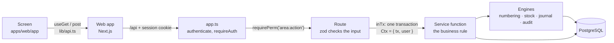
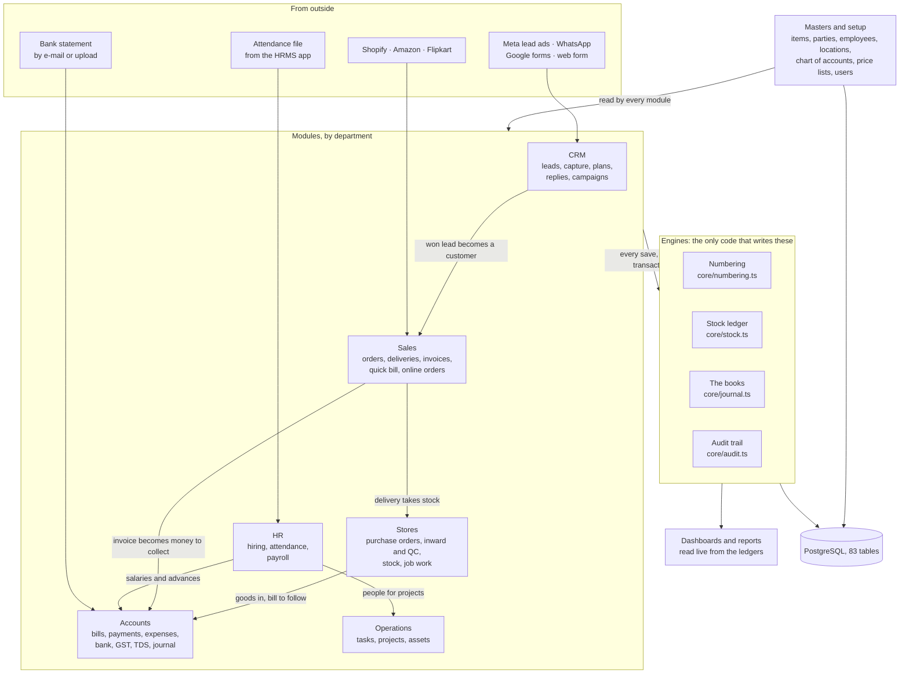
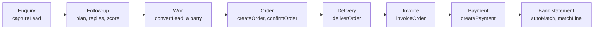
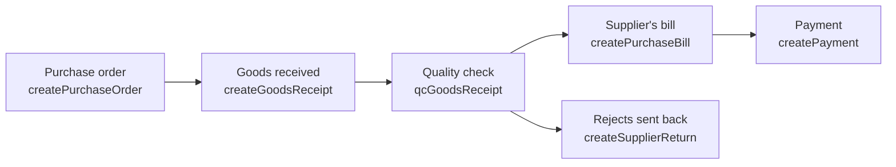
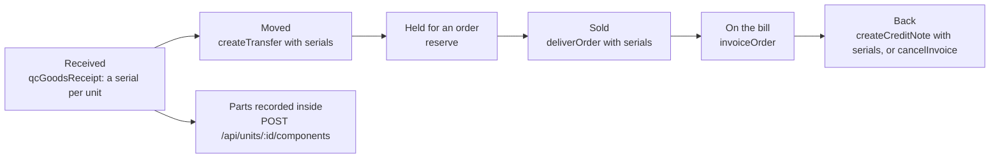
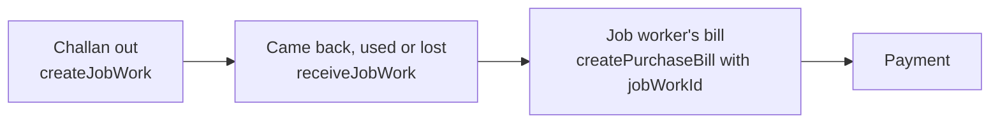
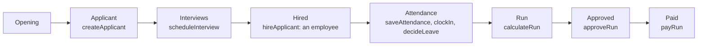
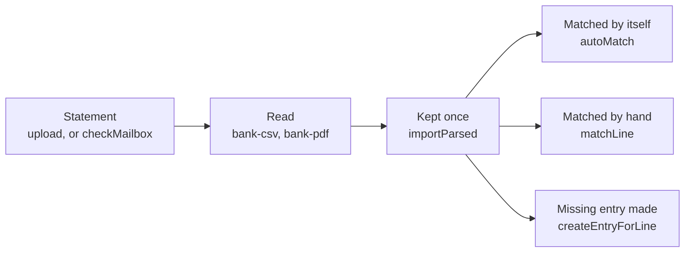

# RadCore: how it is put together

For a developer picking this up. Read this first, then `docs/PROGRESS.md` for what is built and
what is not. Every source file starts with a description of what it is for, and long files are
divided into named sections, so the code can be read top-down from here.

Contents:
[1. The three programs](#1-the-three-programs) ·
[2. One request, start to finish](#2-one-request-start-to-finish) ·
[3. The whole system](#3-the-whole-system) ·
[4. Rules that hold everywhere](#4-rules-that-hold-everywhere) ·
[5. Module by module](#5-module-by-module) ·
[6. What each document posts](#6-what-each-document-posts) ·
[7. The journeys](#7-the-journeys) ·
[8. The database](#8-the-database) ·
[9. The web app](#9-the-web-app) ·
[10. Adding a feature](#10-adding-a-feature) ·
[11. Running and testing](#11-running-and-testing) ·
[12. Known debts](#12-known-debts)

## 1. The three programs

One repository, three npm workspaces.

| Workspace | What it is | Depends on |
|---|---|---|
| `packages/shared` | Rules both sides must agree on: money and rounding, GST, roles and permissions, fixed lists, payroll and TDS arithmetic. Plain functions, no database, no screens. | nothing |
| `apps/api` | The API. Express 5, Drizzle ORM, zod, PostgreSQL (PGlite in development and tests). All business rules live here. | shared |
| `apps/web` | The screens. Next.js (App Router), React, plain CSS. Holds no business rules: it shows what the API returns and sends what the person typed. | shared (and the API over HTTP) |

On a server the web app and the API run side by side and the web app passes `/api` through to
the API (`apps/web/next.config.mjs`). On Vercel there is one deployment, so the API is built
into the web app (`apps/web/scripts/embed-api.mjs`, `apps/api/src/serverless.ts`).

## 2. One request, start to finish

Every screen takes the same road. That sameness is what keeps the modules consistent with each
other: no module has its own way of numbering a document, moving stock or writing to the books.



- `app.ts` is the list of everything the API offers, in the order a request meets it.
- A route does three things: checks the permission, checks the input with zod, and calls a
  service function inside `inTx`. The service function holds the rule.
- A service function takes `ctx` (`{ tx, user }`) so that it can be called from a route, from
  another service function, or from a test, always inside the caller's transaction.
- Anything that goes wrong is thrown (`lib/errors.ts`). The transaction rolls back and the
  screen gets `{ error: { code, message } }` with a message a person can act on.

## 3. The whole system



Because the masters and the engines are shared, a delivery in Sales, a receipt in Stores and a
salary in HR all end up in the same stock ledger and the same books.

## 4. Rules that hold everywhere

These are the conventions the code already follows. Keep to them and a new module fits in.

1. **One request, one transaction.** Routes wrap their work in `inTx(db, req, fn)`. A quick bill
   writes the order, the invoice, the stock movement and the payment together, or none of them.
2. **The route names the permission.** `requirePerm('area:action')`. Which roles hold it is one
   table, `PERMISSIONS` in `packages/shared/src/constants.ts`, which an admin can change on
   screen. `admin` can always do everything. The web app hides what a person may not do, but
   that is a convenience: the API is what refuses.
3. **Only the engines write the ledgers.** Journal entries go through `postJournal` and
   `reverseJournals`; stock through `stockIn` and `stockOut` (the two exceptions, a transfer and
   a job work receipt, are explained at the top of `core/stock.ts`); numbers through
   `nextNumber`; history through `audit`.
4. **Nothing is edited away.** Journal lines, stock movements and the audit log are only ever
   added to. Cancelling a document writes the mirror image. An issued invoice cannot be changed:
   it is corrected with a credit note or cancelled, and the original stays on record.
5. **Stock and books move together.** The module that moves stock posts the value the stock
   engine returns to the Stock in Hand account in the same transaction.
   `GET /api/accounting/reports/integrity` checks that the two still agree, and the tests call
   it after every journey.
6. **Money is never a float.** Amounts and quantities are `numeric` in the database, text on the
   wire, and `Decimal` in arithmetic (`packages/shared/src/money.ts`). Use `D()`, `money()`,
   `round2()`.
7. **Balances and totals are not stored.** What a customer owes, stock on hand, a trial balance,
   a GST return: each is a query over the ledgers at the moment it is asked for.
8. **Fixed lists, not free text.** Every stage, status and kind is a list in
   `packages/shared/src/constants.ts` and an enum in the database.
9. **snake_case on the wire.** Requests and responses use the database's column names. The
   conversion from the ORM's camelCase happens once, in `app.ts`.
10. **Dates are India dates.** `istDate()` for "today", plain `YYYY-MM-DD` text for dates, the
    financial year from `fyOf()`.
11. **The outside world is passed in.** Calls to Meta, the mailbox and the like arrive as `deps`
    (`AppDeps` in `app.ts`), so tests replace them and nothing in a test touches the network.
12. **Comments say why.** A description at the top of each file says what it is for; a comment
    on a function says what it guarantees or why it is the way it is, not what the next line does.
13. **Cost price stays with costs:read.** `hideCosts` (in `lib/http.ts`) is mounted in `app.ts` in
    front of items, sales, purchasing, masters and stock: for anyone without `costs:read` it takes
    purchase cost, unit cost, average cost, valuation, COGS and margins out of every answer and
    every download. A new route under those mounts is covered without doing anything; a route
    elsewhere that shows cost must check `seesCosts(req)` itself.
14. **Serialised stock moves by unit.** For an item with `is_serialised`, every stock movement in
    or out of a place (except Rejected) names its one unit (`core/units.ts`: `unitsIn`,
    `unitsOut`, `unitsMove`), so the units at a place always equal the stock there.
15. **Every document belongs to a legal entity.** The column defaults to the first one
    (`rc_default_entity()`); a document of another entity passes its `entityId` to
    `nextNumber`, `getCompany` and `postJournal`.

## 5. Module by module

All in `apps/api/src/modules/`. "Posts" lists the kinds of journal entry (`ref_type`) a module
writes. A dash means none.

| File | Mounted at | Keeps (tables) | Calls | Posts |
|---|---|---|---|---|
| `leads.ts` | `/api/leads`, `/api/public` | leads, lead_activities | parties, plans | - |
| `crm.ts` | `/api/hooks`, `/api/crm` | channel_events, message_templates, ad_spends | leads, online, plans | - |
| `lead-tools.ts` | `/api/leads` (import, bulk assign, plans) | follow_up_plans | leads, plans | - |
| `plans.ts` | no routes: called by the three above | (works on leads) | - | - |
| `shares.ts` | `/api/leads/:id/shares`, `/api/public/shares` | lead_shares | files | - |
| `parties.ts` | `/api/parties` | parties | - | - |
| `items.ts` | `/api/items` | items, item_images, channel_item_map | - | - |
| `sales.ts` | `/api/sales` | sales_orders, deliveries, invoices and their lines, invoice_links | items, parties, leads, payments, credits | delivery, invoice, credit_note, invoice_cancel, credit_note_cancel |
| `credits.ts` | no routes: served through `/api/sales` | credit_applications | - | - |
| `collect.ts` | `/api/payments/reminders`, `/api/public/invoices` | payment_reminders | sales | - |
| `online.ts`, `online-router.ts` | `/api/sales/online`, `/api/hooks/shopify` | channel_events | parties, sales, crm | - |
| `purchasing.ts` | `/api/purchasing` | purchase_orders, goods_receipts, purchase_bills, purchase_returns and their lines | jobwork | goods_receipt, purchase_bill, purchase_return |
| `inventory.ts` | `/api/stock` | stock_transfers, stock_adjustments and their lines | reservations | stock_adjustment |
| `units.ts` | `/api/units` | units, unit_events, batches (written by `core/units.ts` from the documents) | - | - |
| `reservations.ts` | `/api/sales` (holds on orders) | stock_reservations | - | - |
| `jobwork.ts` | `/api/jobwork` | job_works, job_work_receipts and their lines | - | job_work_receipt |
| `payments.ts` | `/api/payments` | payments, payment_allocations | credits | payment (and its exchange difference) |
| `accounting.ts` | `/api/accounting` | accounts, expenses, fiscal_closes | - | expense, manual, transfer, year_close |
| `bank.ts` | `/api/bank` | bank_statement_lines, bank_line_matches, bank_feeds | accounting, payments | manual |
| `bank-mail.ts` | `/api/bank/mail`, `/api/hooks/bank-mail` | bank_mails, bank_feeds | bank | - |
| `gst.ts` | `/api/gst` | none: read-only | - | - |
| `tds.ts` | `/api/tds` | tds_rates, tds_deposits | - | tds_deposit |
| `hr.ts` | `/api/hr` | job_openings, applicants, interviews, employees, attendance | - | - |
| `hr-self.ts` | `/api/hr/me`, `/api/hr/leave-requests` | leave_requests (and attendance) | - | - |
| `payroll.ts` | `/api/payroll`, `/api/public/payslips` | payroll_runs, payslips, salary_advances, advance_recoveries | - | payroll, payroll_payment, salary_advance |
| `ops.ts` | `/api/ops` | task_templates, tasks, assets, maintenance_schedules, maintenance_logs | - | - |
| `projects.ts` | `/api/ops/projects`, `/api/ops/allocations` | projects, allocations | ops | - |
| `dashboards.ts` | `/api/dashboards` | none: read-only | gst, ops | - |
| `admin.ts` | `/api/auth`, `/api/users`, `/api/settings`, `/api/masters` | users, lead_sources, lost_reasons, campaigns, item_categories, locations, expense_categories, price_lists, entities, branches, tax_rates | - | - |
| `files.ts` | `/api/files` | files, file_contents | - | - |
| `service.ts` | `/api/service`, `/api/public/estimates` | warranty_rules, fault_codes, job_cards and their lines, media and faults, supplier_claims | items, sales | job_card (parts issued), supplier_claim |
| `imports.ts` | `/api/imports` | import_shipments, import_shipment_orders, landed_cost_lines, landed_cost_applications, landed_cost_allocations | - | landed_cost_line (duty paid), landed_cost (applied to the goods) |
| `pipeline.ts` | `/api/pipeline` | test_rides (and delivery_checks through sales) | parties, payments, reservations, sales | - |
| `opening.ts` | `/api/opening` | none of its own: makes parties, items and opening stock | inventory, parties | opening_balance (a party's), opening_accounts |
| `health.ts` | `/api/settings/health`, `/api/hooks/jobs` | none: reads error_log and the job state | (core/jobs) | - |

There are no import cycles between modules: the "Calls" column only ever points one way. Two calls cross the
usual direction on purpose: `payroll.ts` calls `hr.ts` (a salary from a date, `recordSalary`), and `core/jobs.ts`
calls the modules whose work runs by itself (ops, reservations, bank-mail); nothing they call calls back.

Beside the modules:

| Folder | What is in it |
|---|---|
| `core/` | The engines: `auth`, `numbering`, `stock`, `units` (serials), `journal`, `audit`, `settings`, `taxrates` (the GST rate on a date), `stages` (lead stage groups), `access` (who opened a full record), `gst-lock` (a month whose return is filed), `alerts` (error log and the alert channel), `jobs` (the background jobs and their scheduler). |
| `lib/` | Tools with no business rules: `errors`, `http` (the zod checks, `inTx`, `sendList`), `idempotency` (a save repeated with its key is done once), `xlsx`, `bank-csv`, `bank-pdf`, `mailbox` (and the signature check on a statement mail), `secret-box`. |
| `db/` | `schema.ts` (every table), `client.ts` (one `DB` type for PostgreSQL and PGlite), `seed.ts` (what a new installation needs), `demo.ts` (sample data). |
| `app.ts`, `server.ts`, `serverless.ts`, `prepare.ts`, `config.ts` | The front door, the two ways of running it, and the settings from the environment. |

## 6. What each document posts

Account names are the ones in the seeded chart of accounts; the code refers to them by key
(`SystemAccount` in `core/journal.ts`).

| Step | Module | Stock ledger | Books |
|---|---|---|---|
| Delivery | sales | out of Stores or Showroom, at average cost | Dr Cost of Goods Sold, Cr Stock in Hand |
| Invoice | sales | - | Dr Debtors (party), Cr Sales, Cr Output GST, Cr Output Cess, round-off |
| Credit note | sales | back in, when restocked | the invoice in reverse; with restock, Dr Stock, Cr Cost of Goods Sold |
| Quality check on goods received | purchasing | accepted into Stores, rejected into Rejected, at the order rate | Dr Stock in Hand, Cr Goods Received Not Billed |
| Purchase bill | purchasing | - | Dr Goods Received Not Billed (goods) or Purchases (services), Dr Input GST, Cr Creditors (party) |
| Supplier return | purchasing | out of Rejected | Dr Creditors, Cr Stock in Hand, Cr Input GST |
| Payment received | payments | - | Dr Bank or Cash, Dr TDS Receivable (if held back), Cr Debtors |
| Payment made | payments | - | Dr Creditors, Cr Bank or Cash, Cr TDS Payable |
| Foreign bill paid at another rate | payments | - | gain: Dr Creditors, Cr Foreign Exchange Gain / Loss; a loss the other way round |
| Expense | accounting | - | Dr the expense account, Dr Input GST, Cr Bank or Cash, Cr TDS Payable |
| Stock transfer | inventory | out of one place, into another, same value | none |
| Stock adjustment, count | inventory | in or out | Dr or Cr Stock in Hand against Stock Adjustment |
| Opening stock | inventory | in | Dr Stock in Hand, Cr Opening Balance Equity |
| Job work challan | jobwork | Stores to With job workers, same value | none |
| Job work receipt | jobwork | back to Stores; made goods in at what was used plus the charge | charge: Dr Stock, Cr Job Work Charges to be Billed. Loss: Dr Stock Adjustment, Cr Stock |
| Job worker's bill | purchasing | - | Dr Job Work Charges to be Billed (up to what was accrued), rest to Purchases, Dr Input GST, Cr Creditors |
| Salary advance | payroll | - | Dr Staff Advances, Cr Bank or Cash |
| Salaries approved | payroll | - | Dr Salaries, Cr Salaries Payable, Cr PF, ESIC, PT and TDS Payable, Cr Staff Advances |
| Salaries paid | payroll | - | Dr Salaries Payable, Cr Bank |
| TDS paid over | tds | - | Dr TDS Payable, Cr Bank |
| Transfer between own accounts | accounting | - | Dr the account it went to, Cr the account it came from |
| Year-end close | accounting | - | every income and expense account emptied into Retained Earnings |

Cancelling any of these writes the same entry with debit and credit swapped (`reverseJournals`),
dated the day of the cancellation.

## 7. The journeys

### Enquiry to money in the bank



`quickBill` does order, delivery, invoice and payment in one transaction for the store counter.
An online order (`takeOrder` in `online.ts`) joins at the order step, already confirmed.

### Purchase order to paying the supplier



### A unit by its serial



A sale checks the price first (`confirmOrder`: below cost or over the seller's discount limit
needs `sales:approve_discount`) and the customer's credit on what is not paid now.

### Job work



### Opening to salary



### Bank statement to reconciled books



## 8. The database

- **Schema:** `apps/api/src/db/schema.ts`, in sections that follow the departments. Money is
  `numeric(12,2)`, quantities `numeric(12,3)`. Every table has `created_at`, `updated_at`,
  `created_by`.
- **Migrations:** `apps/api/drizzle/NNNN_name.sql`, made by running
  `npx drizzle-kit generate --name <name>` in `apps/api` after changing `schema.ts`, and applied
  in order when the API starts (or, on Vercel, when it is built). Never edit a migration that
  has been pushed: add another.
- **Rules the database enforces itself** (first migrations), each with its own error code that
  `lib/errors.ts` turns into a message:
  - `RC001` journal lines, journal entries, stock movements and the audit log cannot be changed or deleted
  - `RC002` an entry's debits must equal its credits (checked at commit)
  - `RC003` nothing can be posted on or before the period lock date
  - `RC004` an issued invoice and its lines cannot be changed, except for cancelling it and its
    e-invoice and e-way bill references (rewritten in `0032_einvoice_fields`)
  - `unit_events` is append-only (`RC001`), and a stock movement that names a unit moves exactly one
- **Views** the code reads rather than recomputing: `v_invoice_outstanding`, `v_bill_outstanding`
  (cleared by payments plus their exchange difference), `v_party_balances`, `v_stock_on_hand`
  (`qty` on hand, `reserved` by open holds, `available` the difference), `v_item_valuation`.
- **Indexes:** every list of "rows of a document" is indexed on the document it belongs to, and
  the ledgers on what they are searched by (account, party, item and place, document reference).
- **Two drivers, one type.** `DB` in `db/client.ts` is satisfied by node-postgres (real
  PostgreSQL) and by PGlite (in memory or on disk, no install), so development and most tests
  need no database server. Use `rows(db, sql\`...\`)` for raw SQL: it returns the same shape on both.

## 9. The web app

- `app/(app)/layout.tsx` is the frame; the menu (`NAV`) is in `lib/nav.ts`. Each menu entry names the permission
  that shows it.
- `app/(app)/<address>/page.tsx` is one screen. A screen loads with `useGet`, changes things with
  `post`/`put`/`patch` (`lib/api.ts`) and calls `reload()` afterwards. There is no client-side
  store. `useGet` remembers each answer for the visit: a screen opened again shows its last answer
  at once and asks afresh behind it, and two pieces asking for the same address at the same moment
  share one request. Nothing needs keeping in step: every screen still asks the server each time
  it opens, `reload()` always goes to the server, and signing in or out reloads the page, which
  forgets everything.
- `components/ui.tsx` is the kit: `Page`, `Table`, `Form` (driven by a list of fields),
  `ActionButton`, `Card`, `Badge`, `Modal` and `FormModal` (pop-ups), `ViewSwitch` with
  `useRemembered` (Board / List, Table / Chart, kept in the browser), and how money, quantities
  and dates are shown. A screen should be these plus its own data.
- **A record page** (an order, a lead, a product) passes `status` and `smart` to `Page`: the title
  with `SmartButton`s for its related records (with counts), then a bar with what can be done now
  and a `StatusBar` of its stages. Keep new record pages to this layout. A list whose records wait
  at stages starts with `CountCards`, which also filter it; `Tabs` split a long record.
- The menu is `lib/nav.ts`: the side menu and the home screen's section tiles both read it.
- `components/board.tsx` is a board of cards dragged between columns (mouse, and touch by holding
  a card). It only reports a drop or a click; the screen decides what a move means and may ask
  for something in a pop-up first. Tasks and projects use it (`TaskBoard` in `components/ops.tsx`).
- Other files in `components/` are pieces more than one screen uses (the invoice as a document,
  the payslip, charts, the masters, lead tools, reports).
- `app/login`, `app/enquiry/[token]`, `app/i/[token]`, `app/p/[token]`, `app/s/[token]` are the
  pages outside the signed-in area: sign-in, the public enquiry form, and the links sent to
  customers and staff (invoice, payslip, shared file).
- Print layouts are ordinary pages with a print stylesheet (`.no-print`, `@media print` in
  `globals.css`).
- **Colours are tokens.** The top of `globals.css` holds every colour twice: light (`:root`) and
  dark (`:root[data-theme='dark']`). The rest of the file only uses the tokens, so a new style
  should too, and then works in both. A script in `app/layout.tsx` sets `data-theme` before the
  page is drawn, from the person's choice in their menu (`components/theme.tsx`, kept in the
  browser) or else the phone or computer's own setting. Printable documents (`.doc`) stay
  paper-white in both.

## 10. Adding a feature

The order that has worked for every module so far:

1. **Fixed lists and permissions** in `packages/shared/src/constants.ts` (new values at the end
   of a list; a `'thing:read'` and `'thing:write'` line in `PERMISSIONS`).
2. **Tables** in `apps/api/src/db/schema.ts`, then `npx drizzle-kit generate --name thing` in
   `apps/api`. Index the columns the screens will search by.
3. **The module**, `apps/api/src/modules/thing.ts`: a description at the top, service functions
   that take `ctx`, then a `thingRouter(db)` at the bottom whose routes check the permission,
   parse with zod and call the service inside `inTx`. Use `nextNumber` for a document number
   (add the series in `core/numbering.ts`), `stockIn`/`stockOut` and `postJournal` if it touches
   stock or money, `audit` for every change.
4. **Mount it** in `apps/api/src/app.ts`, under its department.
5. **Tests**, `apps/api/test/thing.test.ts`: work the figures by hand first, then assert them
   through the API as a user of the right role (`setup()` and `w.as('accounts')` in
   `test/helpers.ts`), and finish with `expectBooksHealthy`. If the feature hands data to
   another section, add a step to `test/story.test.ts` or a story to `test/story-more.test.ts`:
   they follow the business through every section and are the check that the sections stay connected.
6. **The screen**, `apps/web/app/(app)/thing/page.tsx`, and a line in `NAV`.
7. **The record**: a row in `docs/PROGRESS.md`, and this file if a new module or journey was added.

## 11. Running and testing

```bash
npm install
npm run demo        # API on an in-memory database with sample data + the web app, http://localhost:3000
npm run dev         # the same two programs on a database that is kept (apps/api/.data)
npm run typecheck   # all three workspaces; unused variables and imports are errors
npm test            # shared (31 tests) then API (366 tests on an in-memory database)
```

To run the API tests on real PostgreSQL as CI does, set `TEST_DATABASE_URL` to any database on
a server you may create databases on; each test file then gets its own database, and eight more
tests (simultaneous requests) run.

`test/robustness.test.ts` reads every route from the code (the mounts in `app.ts` and each
router) and checks them all: nobody signed out gets in, no role gets past a permission it does not
hold, and nothing sent to any route (bad ids, wrong types, impossible dates, huge numbers, broken
JSON) makes it fail with a 500. A new route is covered without being added there. The README covers running on a server and on Vercel.

## 12. Known debts

Stated plainly so that nobody has to discover them:

- **Loose types on the web side.** Screens treat API responses as `any` (about 300 places).
  The API validates everything it is sent, so this costs editor help rather than correctness,
  but typed responses shared from the API would be the next step.
- **Large modules.** `hr.ts`, `sales.ts`, `crm.ts`, `purchasing.ts`, `accounting.ts` and
  `ops.ts` are 650 to 1,050 lines each. They are sectioned, and each could be split along its
  section lines (rules in one file, routes in another) without changing behaviour.
- **SQL in routes.** List and report routes carry their SQL inline. That keeps a query next to
  the route that serves it, at the price of long route handlers.
- **No linter.** Style is held by convention and by the compiler's unused-code checks only.
- **Never run against the real services:** the Meta and WhatsApp connections, the statements
  mailbox, and the PDF statement reader (which has only seen statements made for the tests).
  See `docs/PROGRESS.md` for the full list of what is not proven.
